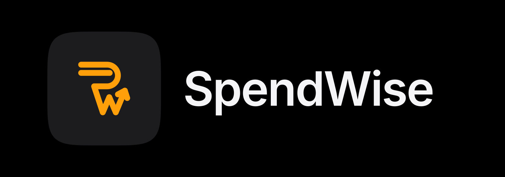

# SpendWise for Android

A native Android app for [SpendWise](https://github.com/shuvrasankha/spendwise), the personal-finance
web app. Both apps share one Firebase project, so whatever you add on one shows up on the other.

## Features

- **Expenses**: add and edit expenses with category icons, split a bill, repeating bills and EMIs
- **Income**: add and edit income, see recent entries
- **Debts**: what you owe and are owed, with sharing, claims, part-payments and a by-person view
- **Dashboard**: the month at a glance, bills due, a score, goals, and day, week, month and year views
- **History**: search, filters and CSV export
- **Insights**: a forecast and cards for each period
- **Investments**: holdings and the money you've put in
- **Budgets and goals**, with an AI budget suggestion (one a month per account)
- **CSV import**, read with AI
- **App lock** with your fingerprint, face or screen lock
- **Home-screen widget** showing today's spending, with a + button to add an expense
- **Daily reminder**, notifications, and Play Store in-app updates
- Light and dark themes (they follow the system unless you choose one), with a choice of currency

## Tech stack

Kotlin · Jetpack Compose · Material 3 · MVVM · Hilt · Coroutines and Flow · Firebase Auth and Firestore
(offline persistence on) · Credential Manager for Google Sign-In · Navigation Compose · DataStore ·
WorkManager. Charts are drawn with Compose Canvas.

minSdk 26 · targetSdk 37 · application ID `com.spendwise.app`

## Project layout

```
app/src/main/java/com/spendwise/app/
  data/      repositories, Firestore mappers, DataStore prefs
  domain/    plain Kotlin business logic, ported from the web app
  reminder/  daily reminder (WorkManager)
  widget/    home-screen widget
  ui/        Compose screens, one package per feature
  di/        Hilt modules
```

The specs live alongside the code:

- [`ANDROID_SPEC.md`](ANDROID_SPEC.md): every screen, flow and Firestore schema
- [`ROADMAP.md`](ROADMAP.md): how the app gets to parity with the web
- [`CLAUDE.md`](CLAUDE.md): project rules, including the data-compatibility rules

## Building

1. Install Android Studio (latest stable), with JDK 17 or newer.
2. Download `google-services.json` from the SpendWise Firebase project and put it in `app/`.
   Don't commit it; it's gitignored.
3. Add the debug SHA-1 to Firebase so Google Sign-In works.
4. Build and test:

```sh
./gradlew assembleDebug          # APK in app/build/outputs/apk/debug/
./gradlew testDebugUnitTest      # unit tests
./gradlew installDebug           # install on a connected device
```

## Working with the web app

The web app is live and shares the same Firestore data, so collection names, field names, date
formats (local `YYYY-MM-DD`) and amount types must match it exactly. Update documents with
field-path updates, never a whole-document `set`. See `CLAUDE.md` and spec §3 before you touch
anything in `data/`.
